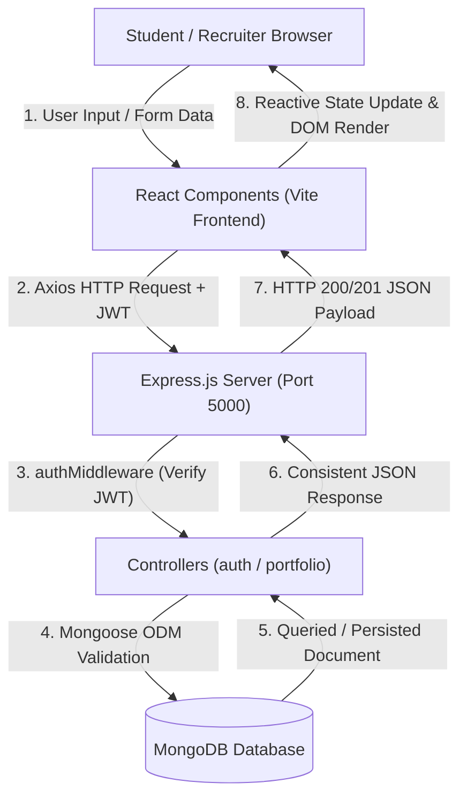

# Smart Digital Portfolio Generator 🎓💼

A modern, responsive, and full-stack web application designed for students and early-career developers to create, customize, preview, publish, and share attractive digital portfolios. Built with the **MERN** stack (MongoDB, Express, React, Node.js) and Vite.

---

## 📑 Table of Contents
1. [Key Features](#-key-features)
2. [Technology Stack](#-technology-stack)
3. [Project Architecture & Directory Structure](#-project-architecture--directory-structure)
4. [Step-by-Step Installation & Setup](#-step-by-step-installation--setup)
5. [Environment Variables Configuration](#-environment-variables-configuration)
6. [Data Flow (Input → Frontend → Backend → Database → Output)](#-data-flow)
7. [Database Schema Design](#-database-schema-design)
8. [REST API Documentation](#-rest-api-documentation)
9. [Security and Privacy Measures](#-security-and-privacy-measures)
10. [Automated Testing Suite](#-automated-testing-suite)
11. [College Project Demonstration & Viva Guide](#-college-project-demonstration--viva-guide)

---

## 🌟 Key Features

- **Intuitive Multi-Section Editor**: Dynamic forms to enter Personal Info, Education, Skills, Projects, Certifications, Honors & Achievements, and Extracurricular Experience.
- **Dynamic Field Management**: Add or remove unlimited educational qualifications, projects, skills with proficiency ratings, and certifications with ease.
- **Form Progress & Completion Meter**: Real-time profile strength meter showing progress as students complete their details.
- **Smart URL Slug Generation**: Automatically generates unique, human-friendly public URLs (e.g., `/portfolio/alex-johnson`).
- **Student Dashboard**: Overview of all portfolios, publication statuses, last-updated timestamps, quick edit, preview, share, and delete actions.
- **Privacy Controls & Draft Protection**: Private drafts are strictly protected and cannot be accessed publicly without being explicitly published.
- **Public Portfolio Viewer**: Clean, lightning-fast public page accessible to recruiters without requiring authentication.
- **Print & PDF Export**: Integrated `window.print()` functionality with dedicated CSS print styles (`@media print`) that removes browser chrome and renders a clean, resume-formatted PDF.
- **Robust Authentication & Ownership Guard**: Secure JWT authentication with bcrypt password hashing ensures users can only view and modify their own portfolios.
- **Resilient Zero-Setup Database Fallback**: Out-of-the-box support for MongoDB Atlas, local MongoDB, or automatic in-memory MongoDB fallback for instant evaluation.

---

## 💻 Technology Stack

### Frontend
- **React 19 with Vite**: Fast client-side rendering and rapid Hot Module Replacement (HMR).
- **React Router (v7)**: Declarative, component-based client-side routing and protected routes.
- **Axios**: HTTP client with request interceptors (JWT header attachment) and centralized response error handling.
- **Lucide React**: Modern, consistent vector icons.
- **Vanilla CSS3 Design System**: Professional typography (Inter font), custom CSS variables, responsive flexbox/grid, modal dialogs, toast notifications, and print media queries.

### Backend
- **Node.js**: Asynchronous JavaScript runtime.
- **Express.js**: RESTful API server architecture with modular routing and controllers.
- **Mongoose**: Object Data Modeling (ODM) library for schema enforcement, validation, and relationships.
- **JSON Web Tokens (JWT)**: Stateless token-based user authentication.
- **bcryptjs**: Salt-based cryptographic password hashing.
- **CORS**: Cross-Origin Resource Sharing middleware.
- **dotenv**: Secure environment configuration loader.

### Database
- **MongoDB**: Flexible NoSQL document database.
- **MongoDB Memory Server**: Built-in automated fallback for instant testing and zero-configuration demonstration.

---

## 📂 Project Architecture & Directory Structure

```
d:/FSD_project/
├── backend/
│   ├── config/
│   │   └── db.js                 # Database connection logic & fallback
│   ├── controllers/
│   │   ├── authController.js     # User registration, login, and profile
│   │   └── portfolioController.js# CRUD operations, slugs, and publishing
│   ├── middleware/
│   │   ├── authMiddleware.js     # JWT verification & req.user attachment
│   │   └── errorMiddleware.js    # 404 handler & centralized error handler
│   ├── models/
│   │   ├── Portfolio.js          # Mongoose schema for portfolios
│   │   └── User.js               # Mongoose schema for user accounts
│   ├── routes/
│   │   ├── authRoutes.js         # /api/auth routes
│   │   ├── portfolioRoutes.js    # /api/portfolios routes (authenticated)
│   │   └── publicRoutes.js       # /api/public routes (unauthenticated)
│   ├── tests/
│   │   ├── api.test.js           # 17 comprehensive backend API tests
│   │   └── e2e-workflow.test.js  # 13 end-to-end user workflow tests
│   ├── .env                      # Environment config (gitignored)
│   ├── .env.example              # Template environment configuration
│   ├── package.json              # Backend dependencies and scripts
│   └── server.js                 # Express server entry point
│
├── frontend/
│   ├── public/
│   │   └── favicon.svg           # Application favicon
│   ├── src/
│   │   ├── components/
│   │   │   ├── forms/
│   │   │   │   ├── AchievementsForm.jsx
│   │   │   │   ├── CertificationsForm.jsx
│   │   │   │   ├── EducationForm.jsx
│   │   │   │   ├── ExperienceForm.jsx
│   │   │   │   ├── PersonalInfoForm.jsx
│   │   │   │   ├── ProjectsForm.jsx
│   │   │   │   └── SkillsForm.jsx
│   │   │   ├── ConfirmationModal.jsx   # Deletion confirmation dialog
│   │   │   ├── ErrorMessage.jsx        # Alert banner with retry action
│   │   │   ├── FeatureCard.jsx         # Landing page feature card
│   │   │   ├── Footer.jsx              # Universal application footer
│   │   │   ├── HeroSection.jsx         # Landing page hero header
│   │   │   ├── LoadingSpinner.jsx      # Animated SVG loading spinner
│   │   │   ├── Navbar.jsx              # Responsive navigation with drawer
│   │   │   ├── PortfolioCard.jsx       # Dashboard portfolio card
│   │   │   ├── PortfolioPreview.jsx    # Live portfolio presentation layout
│   │   │   ├── ProtectedRoute.jsx      # Route guard for authenticated paths
│   │   │   ├── SocialIcons.jsx         # Custom GitHub & LinkedIn SVG icons
│   │   │   └── Toast.jsx               # Floating notification toast
│   │   ├── context/
│   │   │   └── AuthContext.jsx         # Global user authentication state
│   │   ├── pages/
│   │   │   ├── DashboardPage.jsx       # Student portfolio management
│   │   │   ├── HomePage.jsx            # Landing page with sample preview
│   │   │   ├── LoginPage.jsx           # User login page
│   │   │   ├── NotFoundPage.jsx        # 404 page
│   │   │   ├── PortfolioEditorPage.jsx # Multi-section creation/edit form
│   │   │   ├── PortfolioPreviewPage.jsx# Full preview & PDF export
│   │   │   ├── PublicPortfolioPage.jsx # Public-facing portfolio page
│   │   │   └── RegisterPage.jsx        # Student registration page
│   │   ├── services/
│   │   │   └── api.js                  # Axios client with interceptors
│   │   ├── App.jsx                     # Route definitions & layout
│   │   ├── index.css                   # Global design system & print styles
│   │   └── main.jsx                    # React DOM root entry
│   ├── index.html                      # HTML5 template with Inter font
│   ├── package.json                    # Frontend dependencies and scripts
│   └── vite.config.js                  # Vite configuration
│
├── .gitignore                          # Standard git exclusion rules
├── package.json                        # Root monorepo scripts
└── README.md                           # Documentation & viva presentation guide
```

---

## 🚀 Step-by-Step Installation & Setup

### 1. Prerequisites
- **Node.js** (v18 or higher recommended; verified on Node v24)
- **npm** (v9 or higher)
- **MongoDB** (Optional: local MongoDB daemon, MongoDB Atlas, or use the automatic zero-config memory server)

### 2. Clone or Navigate to the Workspace
```bash
cd d:\FSD_project
```

### 3. Backend Setup
1. Open a terminal and navigate to the `backend` folder:
   ```bash
   cd backend
   npm install
   ```
2. Verify or create your `.env` file based on `.env.example`:
   ```bash
   # In Windows PowerShell:
   Copy-Item .env.example .env
   ```
3. Start the backend server:
   ```bash
   # Development mode (with auto-reload):
   npm run dev

   # Standard production mode:
   npm start
   ```
   *The server will start on `http://localhost:5000`.*

### 4. Frontend Setup
1. Open a second terminal and navigate to the `frontend` folder:
   ```bash
   cd frontend
   npm install
   ```
2. Start the Vite development server:
   ```bash
   npm run dev
   ```
   *The frontend application will be live at `http://localhost:5173`.*

---

## ⚙️ Environment Variables Configuration

The backend reads configuration from `backend/.env`. A template is provided in `backend/.env.example`:

| Variable | Description | Example Value |
| :--- | :--- | :--- |
| `PORT` | Port for Express server | `5000` |
| `MONGODB_URI` | MongoDB connection URI (local or Atlas) | `mongodb://127.0.0.1:27017/portfolio_generator` |
| `JWT_SECRET` | Secret key for signing JWT tokens | `replace_with_your_secret` |
| `CLIENT_URL` | Allowed origin for CORS | `http://localhost:5173` |

---

## 🔄 Data Flow



1. **Input Phase**: The student enters academic history, skills, and projects in `PortfolioEditorPage.jsx`.
2. **Client Validation Phase**: Real-time validation checks for mandatory items (Full Name, Headline, Email, Degree, Project Title).
3. **Transmission Phase**: Axios attaches the bearer JWT token in the `Authorization` header and dispatches an HTTP request to `http://localhost:5000/api`.
4. **Backend Authorization Phase**: Express passes the request through `protect` middleware, verifying the JWT signature and ensuring the user exists.
5. **Database Processing Phase**: The controller checks unique slugs and invokes Mongoose schemas to write or retrieve documents from MongoDB.
6. **Output / Render Phase**: The frontend receives the JSON response, updates React state, presents feedback via `Toast`, and renders the interactive digital portfolio.

---

## 🗄️ Database Schema Design

### 1. User Schema (`User.js`)
| Field | Type | Attributes | Description |
| :--- | :--- | :--- | :--- |
| `name` | String | Required, Trim | Student's full name |
| `email` | String | Required, Unique, Lowercase, Regex match | Primary email address |
| `passwordHash`| String | Required | 10-round bcrypt salted password hash |
| `createdAt` | Date | Timestamp | Account creation timestamp |
| `updatedAt` | Date | Timestamp | Last update timestamp |

### 2. Portfolio Schema (`Portfolio.js`)
| Field | Type | Attributes | Description |
| :--- | :--- | :--- | :--- |
| `owner` | ObjectId | Ref: 'User', Required, Indexed | Reference to the portfolio owner |
| `title` | String | Required, Default | Title for internal organization |
| `slug` | String | Required, Unique, Lowercase, Indexed | URL-safe slug for public access |
| `status` | String | Enum: ['draft', 'published'], Default: 'draft' | Public visibility flag |
| `personalInfo` | Object | Required | Full Name, Headline, Email, Bio, Phone, Location, Social URLs |
| `education` | Array | Objects | Institution, Degree, Department, Years, CGPA |
| `skills` | Array | Objects | Skill Name, Category, Proficiency Level |
| `projects` | Array | Objects | Project Title, Description, Technologies, GitHub & Demo links |
| `certifications`| Array| Objects | Title, Issuing Org, Issue Date, Credential URL |
| `achievements` | Array | Objects | Title, Description, Date |
| `experience` | Array | Objects | Organization, Role, Description, Dates |
| `timestamps` | Date | Automatic | `createdAt` and `updatedAt` |

---

## 📡 REST API Documentation

### Authentication Routes (`/api/auth`)
| Method | Endpoint | Access | Body Parameters | Description |
| :--- | :--- | :--- | :--- | :--- |
| `POST` | `/api/auth/register` | Public | `{ name, email, password }` | Registers a new user, returns JWT and user profile |
| `POST` | `/api/auth/login` | Public | `{ email, password }` | Validates credentials, returns JWT token |
| `GET` | `/api/auth/me` | Private | *None* (Bearer Token) | Returns current authenticated user details |

### Portfolio Routes (`/api/portfolios`)
| Method | Endpoint | Access | Description |
| :--- | :--- | :--- | :--- |
| `POST` | `/api/portfolios` | Private | Creates a new portfolio (draft or published) with unique slug |
| `GET` | `/api/portfolios` | Private | Returns all portfolios owned by the authenticated student |
| `GET` | `/api/portfolios/:id` | Private | Fetches specific portfolio by ID (verifies ownership) |
| `PUT` | `/api/portfolios/:id` | Private | Updates portfolio fields and syncs unique slug if altered |
| `DELETE`| `/api/portfolios/:id` | Private | Permanently deletes user's portfolio |
| `PATCH`| `/api/portfolios/:id/publish` | Private | Toggles or updates publication status (`draft` / `published`) |

### Public Routes (`/api/public`)
| Method | Endpoint | Access | Description |
| :--- | :--- | :--- | :--- |
| `GET` | `/api/public/portfolios/:slug` | Public | Returns published portfolio data for recruiters (returns 404 for drafts) |

---

## 🛡️ Security and Privacy Measures

1. **Password Hashing**: Passwords are never saved in plaintext; bcrypt generates a secure cryptographic hash using 10 salt rounds.
2. **Stateless JWT Security**: JWTs contain user IDs with expiration periods (30 days), preventing replay attacks.
3. **Ownership Isolation**: Every portfolio modification query strictly validates `portfolio.owner.toString() === req.user._id.toString()`, responding with `403 Forbidden` for unauthorized attempts.
4. **Draft Privacy**: Public routes (`/api/public/portfolios/:slug`) enforce `status === 'published'`. Drafts return a `404 Not Found` to prevent draft data leakage.
5. **No Password Exposure**: Queries omit password hashes (`.select('-passwordHash')`).
6. **Input Sanitization & Slug Validation**: Slugs are sanitized to URL-safe alphanumeric characters with hyphen delimiters.

---

## 🧪 Automated Testing Suite

The project includes two automated test suites:

### 1. Backend Integration Tests (`backend/tests/api.test.js`)
Tests health checks, registration, login, duplicate account prevention, short password validation, CRUD operations, unauthorized rejections, and draft protections.
```bash
cd backend
npm test
```
*Result: 17 Passed, 0 Failed.*

### 2. End-to-End Workflow Tests (`backend/tests/e2e-workflow.test.js`)
Simulates the complete user lifecycle from registration, draft creation, editing, publishing, anonymous public viewing, cross-user authorization enforcement, unpublishing, and deletion.
```bash
cd backend
npm run test:workflow
```
*Result: 13 Passed, 0 Failed.*

---

## 🎓 College Project Demonstration & Viva Guide

### Project Overview for Evaluators
> *"The Smart Digital Portfolio Generator is a full-stack MERN application that solves the challenge students face when presenting their academic and software projects to recruiters. Rather than sending static PDFs or fragmented GitHub links, students can build a live, interactive, responsive digital portfolio with a custom URL slug and print-ready PDF resume export."*

### Frequently Asked Viva Questions & Answers

#### Q1: Why did you choose MongoDB over a relational database like MySQL?
**Answer**: Portfolios are semi-structured documents. A student's portfolio contains varying numbers of education entries, skills, projects, and certifications. MongoDB's document model allows storing these dynamic sub-documents in an embedded array format without requiring numerous table joins, resulting in faster read performance and greater schema flexibility.

#### Q2: How does the unique URL slug system prevent collisions?
**Answer**: The backend implements an asynchronous slug generation routine (`generateUniqueSlug`). If two students have identical names (e.g., "John Doe"), the first receives `/portfolio/john-doe`, while the system automatically queries the database and assigns the next user `/portfolio/john-doe-2`, `/portfolio/john-doe-3`, ensuring unique indexing in MongoDB.

#### Q3: How is user privacy maintained between draft and published portfolios?
**Answer**: Portfolios maintain a `status` field (`'draft'` or `'published'`). The public route (`GET /api/public/portfolios/:slug`) executes a database query with `{ slug, status: 'published' }`. If a portfolio is a draft, the endpoint returns an HTTP 404, ensuring incomplete or private portfolios are never accessible to external visitors.

#### Q4: How is security handled for edit and delete actions?
**Answer**: Each portfolio document stores an `owner` field pointing to the creating user's `ObjectId`. When a request reaches the controller, the `protect` middleware decodes the JWT and attaches `req.user`. The controller verifies `portfolio.owner.toString() === req.user._id.toString()`. If they do not match, it returns an HTTP `403 Forbidden` response.

#### Q5: How does the Save as PDF / Print feature work without external paid libraries?
**Answer**: The application utilizes standard browser printing (`window.print()`) combined with CSS print media queries (`@media print`). When printing, navigation bars, buttons, and dashboard controls are hidden (`display: none !important`), and the page styles are optimized for standard letter and A4 paper formats.
